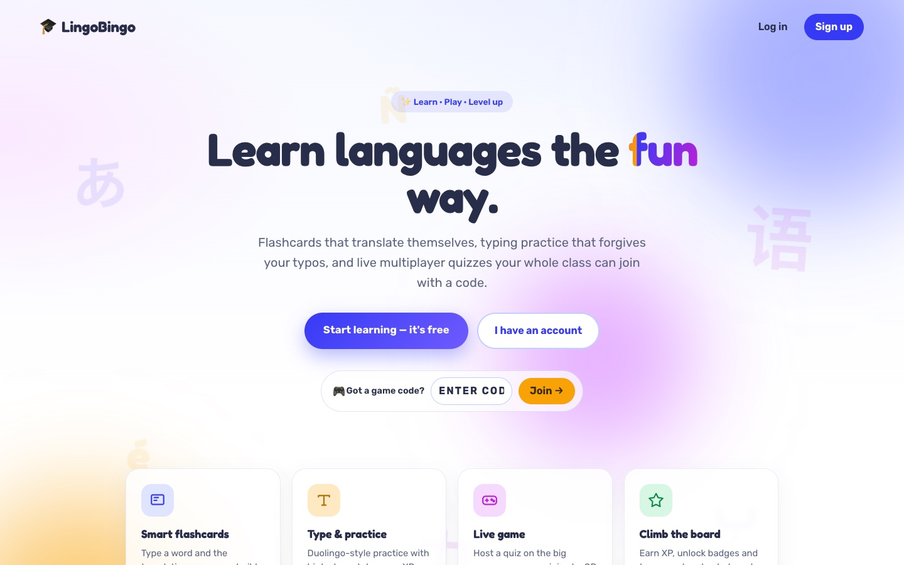
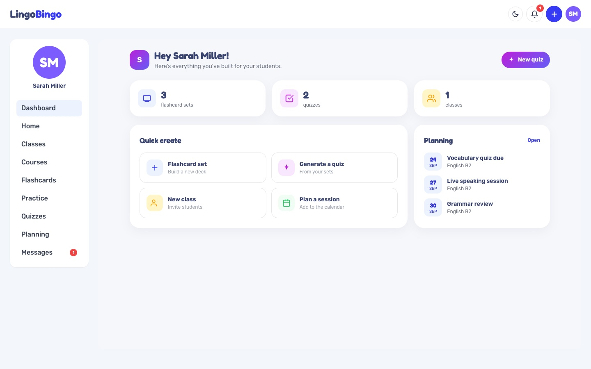
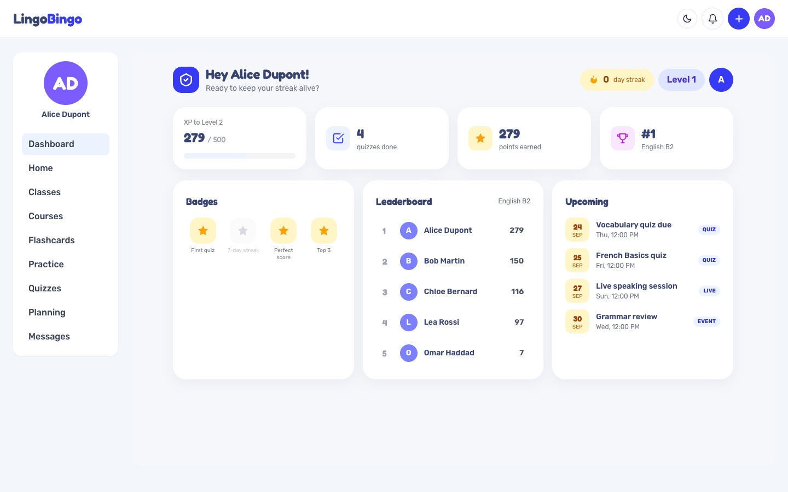
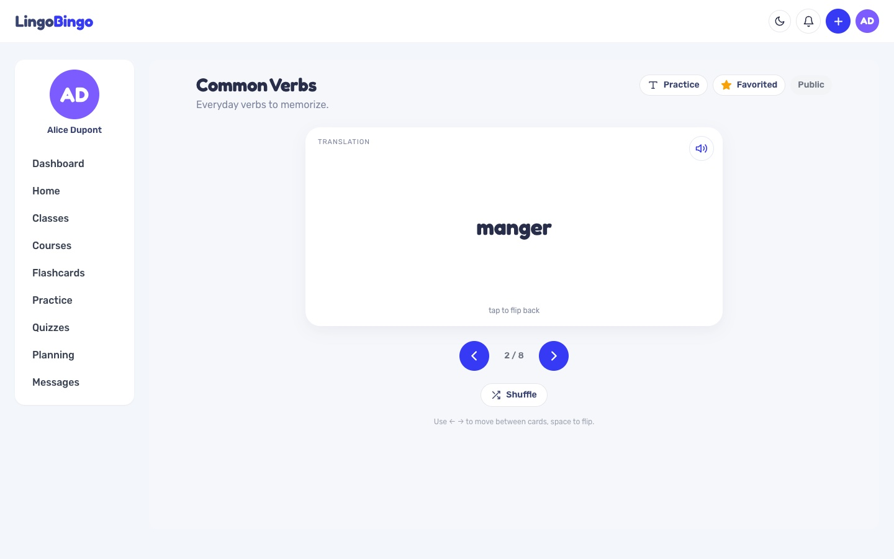
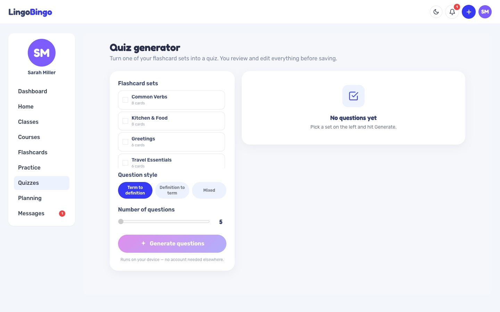
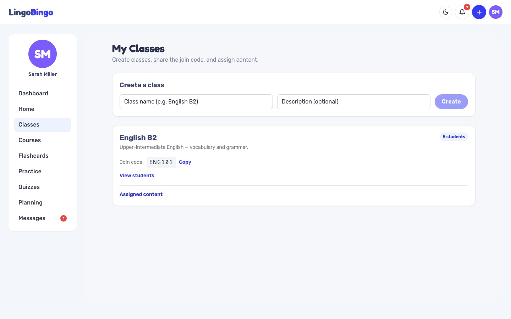
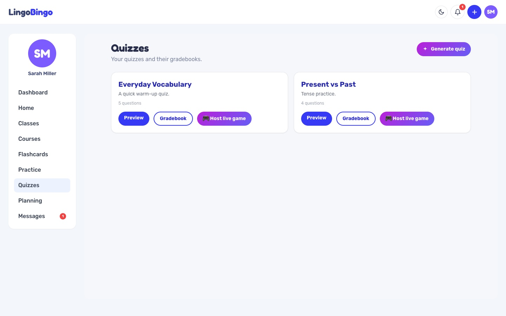
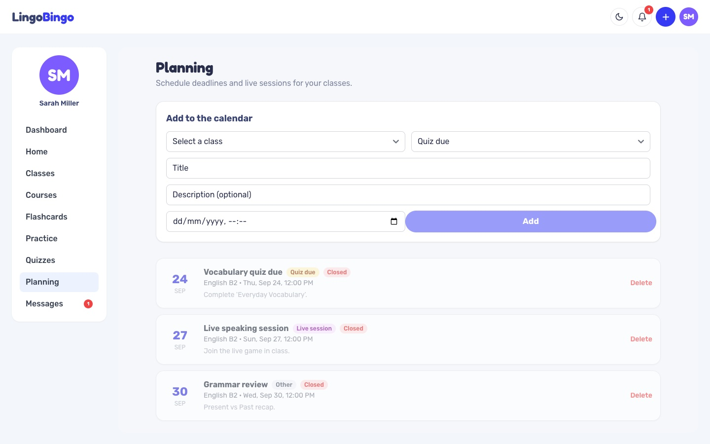
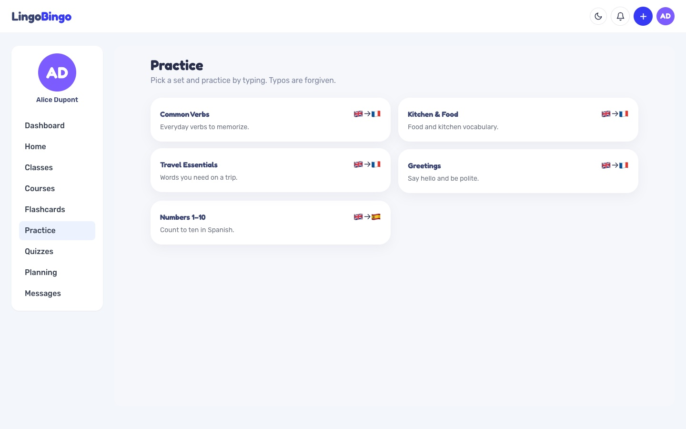

# 🎓 LingoBingo

**A playful, two-sided learning platform — teachers create, students learn, and everyone levels up.**

LingoBingo is a full-stack web application for language and general learning. Teachers build courses, flashcard sets and graded quizzes and organise students into classes; students learn, practise and compete on a gamified dashboard. It is built as a single monorepo and runs end-to-end with one Docker command.

> Built during my 2025 internship at **La Rochelle University**, for an English teacher who wanted Quizlet-style flashcards and Kahoot-style live quizzes in one tool — Angular + Spring Boot + MySQL, containerised with Docker Compose.

<p align="center">
  
</p>

| Landing page | Teacher dashboard | Student dashboard |
|---|---|---|
|  |  |  |
| **Flashcards** | **Quiz generator** | **Classes** |
|  |  |  |
| **Quizzes & live games** | **Planning** | **Type-the-translation practice** |
|  |  |  |

---

## ✨ Features

### For teachers
- **Courses** with rich sections (text + images).
- **Flashcard sets** with **auto-translation while authoring** — type a term and the translation for the other side is suggested automatically (e.g. *strawberries → fraise*).
- **Quizzes** — build by hand (per-question points, options, correct answer) or **generate a draft quiz from a flashcard set** in one click, then edit and save.
- **Classes** with a join code and a roster; **assign** courses, quizzes and flashcards to a class.
- **Planning** — a calendar of deadlines for each class.
- **Gradebook** — every student's quiz result is scored server-side and saved.

### For students
- Learn from courses, study flashcards, and take quizzes that are **scored on the server** (answers never reach the browser).
- **"Type the translation" practice** — a Duolingo-style mode: type the translation, with typo-tolerant checking, letter hints, XP and streaks.
- A **gamified dashboard**: XP, level, daily streak, badges and a class leaderboard.
- See assigned content and upcoming deadlines at a glance.

### Gamification & languages
- **XP, levels and daily streaks** shared across quizzes *and* practice — practising daily keeps your streak alive.
- **Badges** (first quiz, 7-day streak, perfect score, top 3) and a **class leaderboard**.
- **Translation** powered by a cached, key-free translation service; flashcard sets carry a language pair (e.g. EN → FR).

### Platform & security
- **JWT authentication** with role-based access (**ADMIN / TEACHER / STUDENT**, chosen at sign-up).
- Secrets are **externalised to environment variables** (nothing sensitive in the repo).
- **Full light/dark mode** across the whole app.
- Single **Docker Compose** stack (frontend + backend + database).

---

## 🧱 Tech stack

| Layer      | Technology |
|------------|------------|
| Frontend   | Angular 16, TypeScript, Tailwind CSS, Flowbite, ngx-toastr |
| Backend    | Spring Boot 3.2, Java 17, Spring Security (JWT), Spring Data JPA / Hibernate |
| Database   | MySQL 8 |
| Delivery   | Docker & Docker Compose, nginx (serves the frontend and proxies `/api`) |

---

## 🏗️ Architecture

```
Browser
   │  https
   ▼
┌──────────────┐   /api/*   ┌───────────────┐   JDBC   ┌──────────┐
│  nginx        │ ─────────▶ │  Spring Boot   │ ───────▶ │  MySQL 8  │
│  (Angular SPA)│            │  REST API +JWT │          │           │
└──────────────┘            └───────────────┘          └──────────┘
```

- The Angular app is built and served by **nginx**, which also **reverse-proxies `/api`** to the backend — so the browser makes same-origin calls and no CORS is needed in production.
- The backend is a stateless **REST API**; requests carry a **JWT** which Spring Security validates and maps to a role.
- Data lives in **MySQL**; JPA/Hibernate manages the schema (`ddl-auto=update`).

### Monorepo layout
```
LingoBingo/
├── frontend/            # Angular 16 app (nginx in Docker)
│   └── src/app/
│       ├── Components/   # Dashboard, Quizzes, Flashcards, Practice, Classes, Courses, Planning...
│       └── Services/     # Auth, Quiz, Flashcards, Translation, Practice, Theme...
├── backend/             # Spring Boot 3 / Java 17 REST API
│   └── src/main/java/com/lingobingo/
│       ├── Controller/   # REST endpoints
│       ├── Service/      # business logic (stats, translation, scoring...)
│       ├── Entity/       # JPA entities
│       ├── Repository/   # Spring Data repositories
│       └── Configuration/# security, CORS, Jackson
├── docker-compose.yml   # frontend + backend + MySQL
└── .env.example         # secrets template (copy to .env)
```

---

## 🚀 Run with Docker (recommended)

**Prerequisites:** Docker Desktop (or Docker Engine + Compose).

1. Create your environment file and set the two secrets:
   ```bash
   cp .env.example .env
   # edit .env — set SECRET_KEY and MYSQL_ROOT_PASSWORD
   # tip: generate a key with  openssl rand -base64 48
   ```
2. Build and start everything:
   ```bash
   docker compose up --build
   ```
3. Open **http://localhost:8088**

The database persists in the `dbdata` volume. Stop with `docker compose down` (add `-v` to also wipe the database).

### Demo accounts (seeded automatically)
| Role    | Email                     | Password      |
|---------|---------------------------|---------------|
| Teacher | `teacher@lingobingo.com`  | `password123` |
| Student | `alice@lingobingo.com`    | `password123` |
| Student | `bob@lingobingo.com`      | `password123` |

---

## 🧑‍💻 Run locally (development)

**Backend** (JDK 17 + a local MySQL):
```bash
cd backend
cp .env.example .env      # set SECRET_KEY; adjust DB_* for your MySQL
./mvnw spring-boot:run
```

**Frontend:**
```bash
cd frontend
npm install
npm start                 # http://localhost:4200
```

---

## 🎬 Suggested demo flow
1. Sign in as the **teacher**, create an EN → FR flashcard set (watch the translation suggestions), and **generate a quiz** from it.
2. Create a **class**, note the join code, and **assign** the quiz.
3. Sign in as **alice**, join the class, take the quiz, and try **Practice → Type the translation**.
4. Reopen the **dashboard** to see XP, streak, badges and the leaderboard update.

---

## 📄 Notes
- Translation uses the free, key-free MyMemory API (cached server-side); it needs outbound internet and is rate-limited on the free tier — fine for classroom use.
- Quiz answers are never sent to the browser; scoring happens on the server.
- Built by **Meryem Belmouaddine** during an internship at La Rochelle University (April–June 2025).

## 📜 License

[MIT](LICENSE) © 2026 Meryem Belmouaddine
